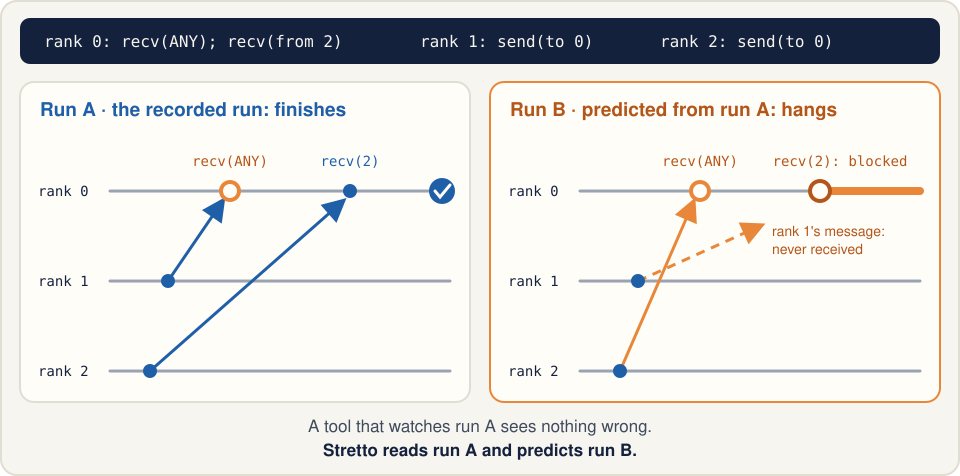
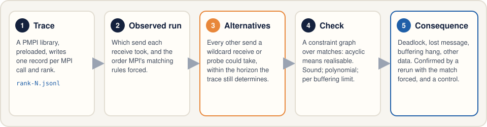
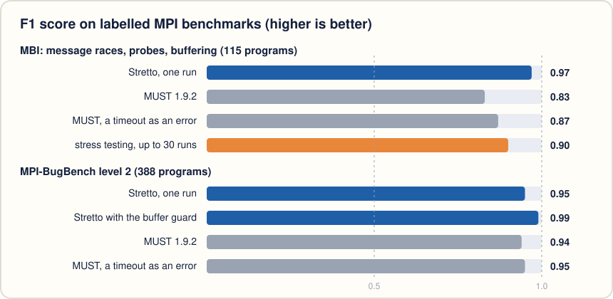
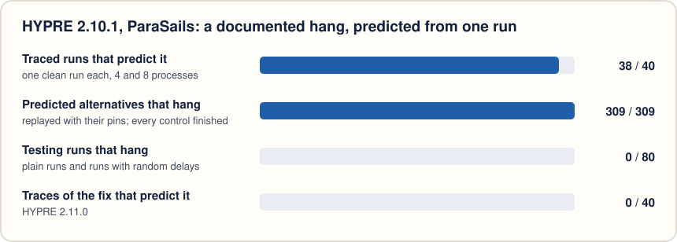
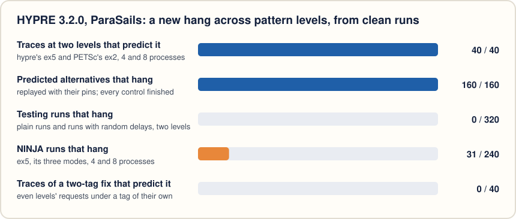
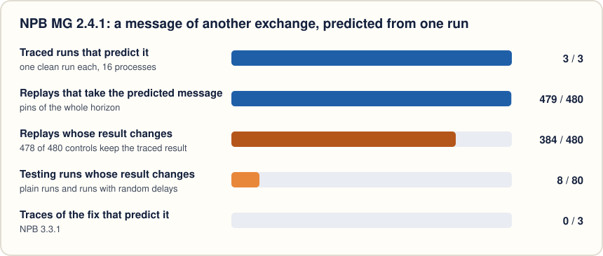
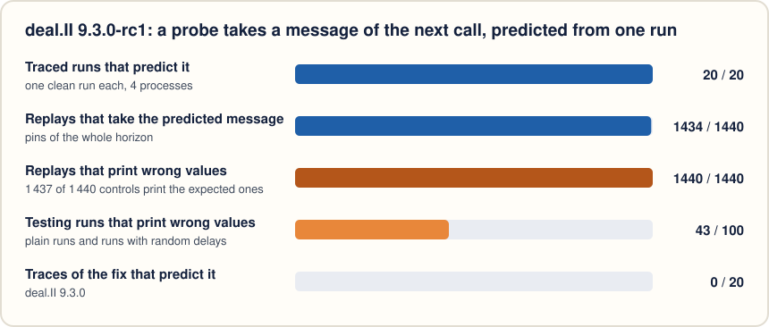

<h1 align="center">Stretto</h1>

<p align="center"><b>Predict MPI message races from one run.</b></p>

<p align="center">
  <a href="LICENSE"></a>
  
  
  
</p>

<p align="center"></p>

Stretto records one run of an MPI program and works out which other matchings of messages to
wildcard receives the same program could have had. It proves which of them are realisable,
says what each would cause (a deadlock, a lost message, a hang that depends on how much MPI
buffers, other data), and confirms its predictions by rerunning the program with the
predicted matches forced.

In a fugue, a *stretto* is the passage where a voice enters before the previous one has
finished, so the entries overlap; messages that overlap and race for one receive are what the
tool is about.

## Why

A receive from `MPI_ANY_SOURCE` takes whichever matching message arrives first, so one program
can match its messages differently from run to run. Most orders are harmless. Some deadlock,
leave a message unreceived, or compute another result, and they may show once in a thousand
runs, on another machine, or only with another MPI library. Testing samples one order per run;
a runtime checker such as MUST judges the run it watches. Stretto asks what the run it watched
says about the runs it did not see.

## How it works

<p align="center"></p>

1. **Trace.** A PMPI library loaded with `LD_PRELOAD` writes one JSON record per MPI call and
   rank: sends, receives, probes, completions, collectives and the sender each receive got.
   No recompilation.
2. **Observed run.** The analysis rebuilds which send each receive took and the order MPI's
   matching rules (non-overtaking, completion, collectives) forced on the run.
3. **Alternatives.** For every wildcard receive or probe, every other send it could have taken.
   The *horizon* is the part of the run that the trace still determines after that one change.
4. **Check.** An alternative is kept only if a constraint graph over matches and the program
   order inside the horizon stays acyclic. The check is sound (an accepted alternative is
   realisable for every program consistent with the trace), takes polynomial time, and is
   repeated per buffering limit, since a send that blocks at 4 KB may not block at 64 KB.
5. **Consequence and replay.** Each accepted alternative is classified, and confirmed by a
   rerun that pins every wildcard receive of its horizon (`replay/`), with a control rerun that
   pins the observed matches; a confirmation needs every pin matched and the control to finish.
   A pin turns a wildcard receive into a receive from one rank, which is another program, so
   the rerun runs under the tracer, and its own trace must also be a run of the program without
   the pins, up to where it ended.

The theory (soundness, monotonicity in the buffering limit, completeness relative to the
horizon, cost) is in [`docs/model.md`](docs/model.md).

## Results

<!-- results:begin -->
<!-- Written by experiments/tables.py from experiments/results/; do not edit by hand. -->

**Labelled benchmarks.** One traced run per program, against MUST (a runtime checker that
judges the run it sees) and stress testing with random delays.

<p align="center"></p>

| corpus | programs | Stretto, one run | false positives | MUST 1.9.2 | stress testing |
|---|---:|---:|---:|---:|---:|
| MBI (message races, probes, buffering) | 115 | **0.97** | 0 | 0.83–0.89 | 0.90, 0.97 with the eager limit forced down |
| MPI-BugBench level 2 | 388 | **0.95**, 0.99 with the buffer guard | 4 | 0.94–0.94 | 0.88, 0.98 forced down, on its 365 call-ordering and correct programs (Stretto 0.99 on them) |

Every MBI error that stress testing never exposes (12 programs, the
buffering-dependent deadlocks) is predicted from a run that finished. With Open MPI's eager limit
forced down so that it buffers no payload byte, the same stress runs hang
8 of them, those that send to another rank, and fail
no correct program
(F1 0.97); the other
4 send to their own rank, which Open MPI buffers at any limit.
Testing finds them once one suspects that buffering matters; Stretto finds them from one run at
the default setting and reports the threshold. The MPI-BugBench misses
are programs that touch a buffer while a nonblocking call still uses it, which no MPI call
records. The buffer guard (`STRETTO_GUARD=1`) watches those buffers in the run itself and finds
20 of the 20 under Open MPI and 22 of
22 under MPICH, with no new false positive.

**One run is one schedule.** Run 10 times, MBI's racing programs fail in some runs
and finish cleanly in others: the run itself shows 26 of the
65 labelled errors every time, 27 only sometimes and
12 never. Stretto reports 61 of them in every run (F1
0.98–1.00, no false positive in any run): of the
234 runs of an erroneous program that showed nothing, it predicts the error
from 222. The other 12 are runs of
4 programs whose error is a check of the received value, which the
value level (L2) decides.

**Reads.** A program reads the result of a receive later, if at all. A static analysis of the
C sources (clang, [`docs/firstread.md`](docs/firstread.md)) bounds where; a deadlock or lost
message the single-path explorer finds then occurs in an execution of every program consistent
with the trace, if its witness execution issues nothing past those bounds. On MBI, 10
erroneous programs (7 with a clean run) get such a consequence; F1 counting
only what needs no single-path assumption rises from 0.00 to
0.27, with 0 new false positives. The 4
value checks still need L2. Against the explorer with read bounds, 0 of
1 648 judged alternatives are unsound.

**A real bug.** HYPRE 2.10.1's ParaSails preconditioner reuses one tag for two exchanges behind
a wildcard probe; a probe can take a request of the next exchange, and the solver hangs. A
message race in HYPRE 2.10.1 hung a production code intermittently for 18 months, and
diagnosing it took 291 jobs and 10,392 compute-node hours (the NINJA noise-injection paper,
PPoPP 2017); HYPRE's changelog for 2.11.0 places the fix in ParaSails. NINJA, the noise injector of that paper, hangs it in 25 of 40 runs at 8 processes (its application-centric mode) and in 11 of 40 with random noise, and never on the fix.

<p align="center"></p>

**A new bug in a current release.** HYPRE 3.2.0's ParaSails, like its master branch, sends the
row requests of every level of its sparsity pattern with one tag and takes them with a wildcard
probe. Nothing collective separates one level's probes from the next level's requests, so with
two or more levels a probe can take the next level's request and the setup hangs: the race above,
which the 2.11.0 fix left in place across levels. Every one of 40 clean two-level runs of
hypre's `ex5` and of PETSc 3.26.0's unmodified KSP tutorial `ex2` (`-pc_type hypre -pc_hypre_type
parasails -pc_hypre_parasails_nlevels 2 -pc_hypre_parasails_thresh 0.01`) predicts it, and none at
one level. Forced, all 160 such alternatives hang with every pin matched, each a run of
the program, and every control finishes. The race needs only the neighbour's 1 340-byte reply
buffered (920 bytes in `ex5`), below Open MPI's default eager limit of 4 040 bytes. None of
320 plain and delayed two-level runs hang: a delay before a call cannot hold back a
request already sent. NINJA, which delays sends in transit, hangs `ex5` in 31 of
240 runs. Giving even levels' requests a tag of their own removes every cross
alternative. Along the way: PETSc passes `-pc_hypre_parasails_nlevels` to HYPRE only when
`-pc_hypre_parasails_thresh` is given too.

<p align="center"></p>

**A second documented bug.** NPB MG 2.4.1 receives every halo exchange from `MPI_ANY_SOURCE`
with a tag that does not depend on the grid level; its changelog says this "could cause MPI_Wait
return a message meant for the wrong k", fixed in 3.2.1. From one clean run Stretto predicts
receives that take a message of another exchange. Forced, 384 of
480 replays compute another residual; 15 of them fail 2.4.1's own
check, an absolute error of 1e-8, and 383 fail the relative check of later
versions. Testing changes the residual in 8 of 80 runs, and
nothing in those runs reports it.

<p align="center"></p>

**A third documented bug.** deal.II 9.3.0-rc1's `RemotePointEvaluation` takes each call's
messages with a wildcard probe under one tag, and nothing separates two calls on one cached
object, so a probe can take a message of the next call; upstream fixed it before 9.3.0 ("fix
race condition if called multiple times"). Every one of 20 clean runs of
deal.II's own test predicts it. Forced, all 1 440 replays finish with status 0
and print wrong values, in the two calls the code predicts; the fix has no such alternative.
Here testing finds the race too: 42 of 50 runs
with random delays print wrong values, 1 of 50
plain runs.

<p align="center"></p>

**Four documented bugs from projects' histories.** Each was fixed and described by its project;
each case builds the version with the bug and its fix and runs a driver that reaches the code
(the project's own unit test or input where there is one). Stress testing is untraced runs,
plain and with random delays.

| bug | clean traced runs that predict it | forced, the predicted execution | controls | stress testing | the fix |
|---|---:|---|---:|---:|---|
| Cabana `createFromImports`, a round-1 wildcard receive takes a round-2 id (PR #835) | 15 of 15 (deadlock, L1+SP) | 160 of 160 replays hang | 160 of 160 finish | 71 of 320 runs hang (4 of 160 plain) | no finding in 15 runs |
| stempy 3.3.5 `gatherEvents`, the map receive takes another worker's size (issue #292) | 30 of 30 (L1) | 360 of 360 replays fail, cereal throws | 360 of 360 correct | 43 of 160 runs fail (0 of 80 plain) | no alternative in 30 runs |
| MFEM 3.3.2 `GroupTopology::Create`, a receive takes the next mesh's row (c52c6243b) | 21 of 24 (L1) | 117 of 120 replays fail (38 of 38 at 4 ranks) | 105 of 120 correct (38 of 38) | 85 of 160 runs fail (37 of 80 plain) | no cross alternative in 40 runs |
| LAMMPS `Irregular::create_atom`, blocking count sends before the receives (411c069b) | 40 of 40 (deadlock below 4 bytes) | 20 of 20 runs hang just below the bound | 20 of 20 finish at it | 0 of 80 plain and 0 of 80 delayed runs hang; 80 of 80 with the eager limit forced down | no finding in 40 runs |

**Soundness in practice.** Against an exhaustive explorer, 0 of
824 judged alternatives are unsound. Replays on MBI: 39
confirmed, 31 inconclusive (the control itself hung),
0 contradicted. Random samples of 30 alternatives on AMG
and on Nekbone: every replay matched its pins and finished, and so did every control.
A pin makes a wildcard receive a receive from one rank, which is another program, so the
replays behind these results (every MBI replay, samples of the application campaigns) were run
again under the tracer and each one's own trace judged as a run of the program without the
pins: 373 of 373 are, and 289 of the 289 confirmations among them
stand when a confirmation needs that too.

**Cost.** Tracing slows NPB by 1.01–1.17× (its own timers). Analysis: lu.A on 16
processes (3.05 M events) in 55 s, AMG in 15.5 s, Nekbone
(10.1 M records) in 34 min and 33 GB.

**Scale.** From 16 to 64 processes, in a container of 12 hardware threads that the
larger counts oversubscribe (so these runs measure the analysis, not the programs), the analysis
of AMG grows from 31 s and 1.0 GB to 416 s and 8.7 GB, about linear in its records
(0.33 M to 2.51 M) plus its probe alternatives (16 934 to 501 881): each alternative
takes 1.8 ms at 16 processes and 0.8 ms at 64 (74 µs per record plus 0.46 ms per alternative fits each trace within 2%). HYPRE's
analysis grows from 4 to 43 s; LU's, with no wildcards, 4.8-fold with its
4.7-fold trace. All 60 sampled replays matched their pins and all but one finished: the one left takes a request probe of HYPRE's ParaSails, the race above; one control exited with status 15, the unexplained exit of some of HYPRE's replays and controls in E5c.

Full tables: [`docs/results.md`](docs/results.md).
<!-- results:end -->

## Quick start

On Ubuntu 24.04 (or in the experiment image, `experiments/container/Dockerfile`):

```bash
sudo apt install openmpi-bin libopenmpi-dev mpich libmpich-dev python3   # system toolchain only
make -C tracer && make -C replay                                         # libstretto-trace.so, libstretto-pin.so
scripts/run_idiom.sh 04                                                  # trace and analyse one small program
```

Idiom 04 is the program of the picture above. Its recorded run finishes, and the report
predicts the deadlock:

```bash
PYTHONPATH=analysis python3 -m stretto analyze -v traces/openmpi/04_orphan_send
PYTHONPATH=analysis python3 -m stretto confirm traces/openmpi/04_orphan_send idioms/04_orphan_send/bin/openmpi/main
```

Your own program: run it once under the tracer, then analyse the trace.

```bash
mpirun -np 4 -x LD_PRELOAD=$PWD/tracer/bin/openmpi/libstretto-trace.so -x STRETTO_TRACE_DIR=traces/mine ./a.out
PYTHONPATH=analysis python3 -m stretto analyze -v traces/mine
PYTHONPATH=analysis python3 -m stretto sites traces/mine          # findings grouped by call site
```

Fortran codes are traced through the MPICH wrappers (`MPI=mpich`): Open MPI's Fortran bindings
call `PMPI_*` directly and bypass the tracer.

### Exit status and output

`stretto analyze` exits with 0 when it reports no finding of an error class, 1 when it reports
one, 2 when the trace (or a `--reads` map) cannot be loaded or a usage error stops it, and 3 on
an internal error, with its traceback. A 0 says that no error was found, not that none can
occur: the report is *degraded* when the analysis could not do all of its work, and the first
line of the text report, `status: complete` or `status: degraded: ...`, says so, as does the
JSON. The reasons:

| reason | what was not done |
|---|---|
| `missing-ranks` | a rank left no trace file: its messages and collectives are missing |
| `tracer-overflow` | a table of the tracer filled up: later records of its kind may be incomplete |
| `unmatched-completions` | a receive completed from a send the trace does not have (an untraced caller, such as Fortran under Open MPI) |
| `guard-off` | the buffer guard was asked for and off (MPI_THREAD_MULTIPLE) |
| `threads` | several threads called MPI under MPI_THREAD_MULTIPLE: no alternative is predicted |
| `unmodelled` | a call outside the modelled fragment (one-sided, neighbourhood collectives, ...): no alternative is predicted |
| `ready-send` | the run issued a ready send before its receive: no alternative is predicted |
| `explorer-skipped` | the trace has more events than `--sp-max-events`: no L1+SP consequence was looked for |
| `explorer-incomplete` | an exploration of the single-path explorer hit its state cap or failed |
| `unconfirmed-rejections` | above 200 000 records the fast check's rejections are not confirmed by the generic check |

`--json` writes `{"schema": 2, "analysis_commit", "status", "degraded": [{"reason", "detail"}],
"summary", "notes", "findings", "infeasible"}`. Each finding carries an `id`, its class and a hash
of what it is about (the changed receive, send or probe, its level, certainty and error), which
stays when the wording of its title changes. `stretto confirm` exits 0, or 2 when the replay
library is missing or does not load.

`-x STRETTO_GUARD=1` adds the buffer guard (class 3-local): between MPI calls the tracer
write-protects the pages of buffers that pending nonblocking operations own and records the
first access the program makes to them, checks each send buffer's checksum at its completion,
and checks every call's buffers against the pending ones. Stack buffers are checked by the
checksum only, and reads only on pages that lie wholly inside a point-to-point receive buffer
(`tracer/mpitrace.c`, "buffer guard", has the rules).

### Replay and pins

`STRETTO_PIN="rank:idx:src[:tag],..."` pins the idx-th wildcard receive of a rank to a source;
`STRETTO_PIN_PROBE` does the same for wildcard probes, and `STRETTO_PIN=@file` reads a list too
long for one environment string. `STRETTO_SEND_DELAY_MS="rank:ms,..."` and
`STRETTO_RECV_DELAY_MS` add delays, which the stress-testing baseline uses. The pins `stretto
confirm` writes also carry the traced operation's identity, `rank:idx:src[:tag]@comm:tag:site`
(its communicator's creation ordinal on the rank, its tag argument, its call site): a replay that
diverged before a pin would otherwise pin another operation and report it matched. The replay
library ends such a run with exit code 86, and the replay is inconclusive (`replay/pin.h`).

Of class 1a only a truncation is confirmable: the receive fails with `MPI_ERR_TRUNCATE`, inside
the call, so its pin shows as applied (and, under the tracer, the receive as pending where the
run stopped) rather than matched. A type signature mismatch and a ready send with no posted
receive are erroneous, but neither Open MPI nor MPICH reports them, so a replay cannot confirm
them and their verdict is `n/a`.

```bash
scripts/replay_idiom.sh 04 0:0:2      # pin rank 0's first wildcard receive to rank 2: the predicted run
```

## Reproducing the evaluation

[`artifact/README.md`](artifact/README.md) maps each research question of the paper to one
target of `artifact/reproduce.sh`, which reruns it in a pinned image and checks the paper's
claims against the new numbers:

```bash
artifact/reproduce.sh image kick tables      # 30 minutes: image, unit tests, numbers from the committed tables
artifact/reproduce.sh inputs rq1 rq3          # for example
```

`experiments/tables.py` regenerates [`docs/results.md`](docs/results.md), the paper's numbers and
the results section of this README from the tables in `experiments/results/`; every row of
those tables names the code commit that produced it. [`experiments/RUNBOOK.md`](experiments/RUNBOOK.md)
describes how the runs were made.

## What Stretto reports

| class | meaning | level |
|---|---|---|
| 1a | alternative message does not fit the receive (count/type) | L1, trace only |
| 1b | alternative message is from another logical channel (tag) | L1, trace only |
| 1c | a send is left unmatched | L1+SP (single-path assumption), or L1 with read bounds |
| 1c | a send was never received in the observed run | observed |
| 1d | deadlock under the alternative | L1+SP, or L1 when contained in the horizon or with read bounds |
| 1e | the twin's continuation diverges from the trace, or the twin aborts on the program's own check | L2 (twin: hand-written, or the program re-executed) |
| 1f | same shape as observed; benign unless the continuation depends on it | L1 |
| 2-buffering | the observed run itself deadlocks below an eager threshold | observed |
| waitany-order | another request could have completed first | L1 |
| probe-alt | a wildcard probe could have observed another message | L1 |
| 2-collective | ranks disagree on a collective (name or participation) | observed |
| 2-blocked | the run ended with a rank blocked in a call or spinning in a polling loop | observed |
| 2-ready | the run issued a ready-mode send before the receive that takes it was posted (alternatives are then not predicted) | observed |
| abort | a rank stopped before MPI_Finalize outside any MPI call, or called MPI_Abort | observed |
| 3-local | the program touched a buffer that a pending nonblocking operation owns, or two pending operations own overlapping bytes (buffer guard, `STRETTO_GUARD=1`) | observed |

L1 findings hold for every program consistent with the trace. "L1+SP" findings also assume the
recorded call sequence does not change after the alternative, which fails on code whose control
flow depends on received data (idioms 01 and 06 show it); level L2 checks such code against a
skeleton of its data dependence. The skeleton is written by hand, or it is the program itself: a
trace made with `STRETTO_PAYLOAD=<bytes>` and `stretto analyze --rerun ./a.out` rerun each rank
whose results change alone under a shim that serves it the recorded messages
([`docs/l2-auto.md`](docs/l2-auto.md)).

Code that never reads what a receive returned needs no skeleton. `python3 -m stretto.firstread
-o reads.json prog.c` finds, from the C sources and clang 18's IR, which MPI calls a program can
only make before it reads a receive's buffer, status, flag or index; with `stretto analyze
--reads reads.json`, the horizon keeps those calls after a changed receive, and a deadlock or
lost message whose single-path witness stays within them is an L1 finding
([`docs/firstread.md`](docs/firstread.md)).

## Repository

| path | what |
|---|---|
| [`tracer/`](tracer/) | the PMPI tracer, `libstretto-trace.so` |
| [`analysis/`](analysis/) | the Python package `stretto` (standard library only) and its tests |
| [`replay/`](replay/) | the pin library, `libstretto-pin.so`: forced sources, delays |
| [`rerun/`](rerun/) | the re-execution shim, `libstretto-rerun.so`: one rank runs alone on given results (level L2) |
| [`idioms/`](idioms/) | fourteen small MPI programs, each with the prediction it should give |
| [`experiments/`](experiments/) | the corpus harness (MBI, MPI-BugBench), the applications, the image, the results |
| [`artifact/`](artifact/) | one reproduction target per research question, and the claims check |
| [`docs/`](docs/) | the model, the first-read bounds, the results, the feasibility gate, the proposal |
| [`scripts/`](scripts/), [`study/`](study/) | idiom scripts; the survey of wildcard sites in proxy applications |

Third-party inputs (MBI, MPI-BugBench, NPB, AMG, Nekbone, HYPRE, MUST's image) are fetched at
pinned versions by `third_party/fetch.sh` and the application scripts, and are not part of the
repository.

## Status

A research prototype; the paper is in preparation. The project was called Rematch until
21 Oct 2026, and results committed before then use that name.

## License

MIT; see [`LICENSE`](LICENSE).
